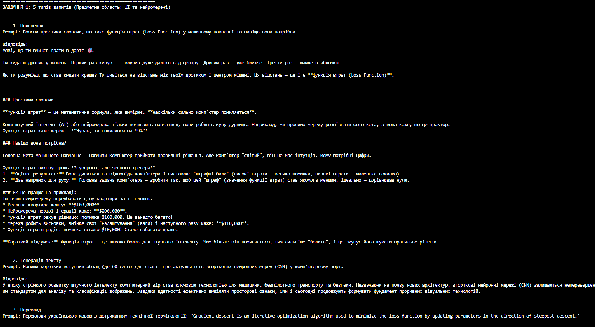
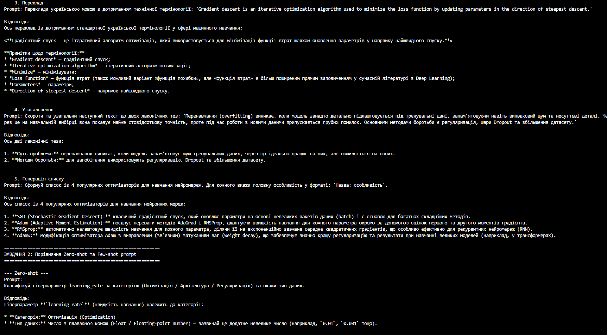
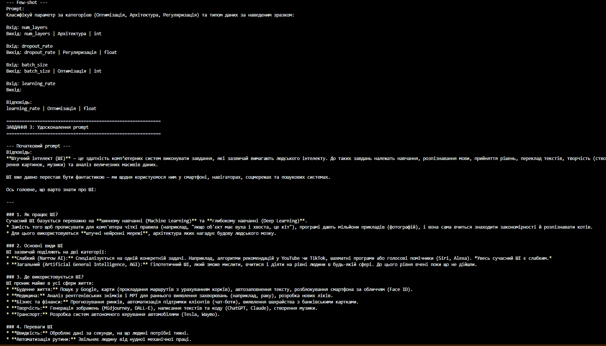
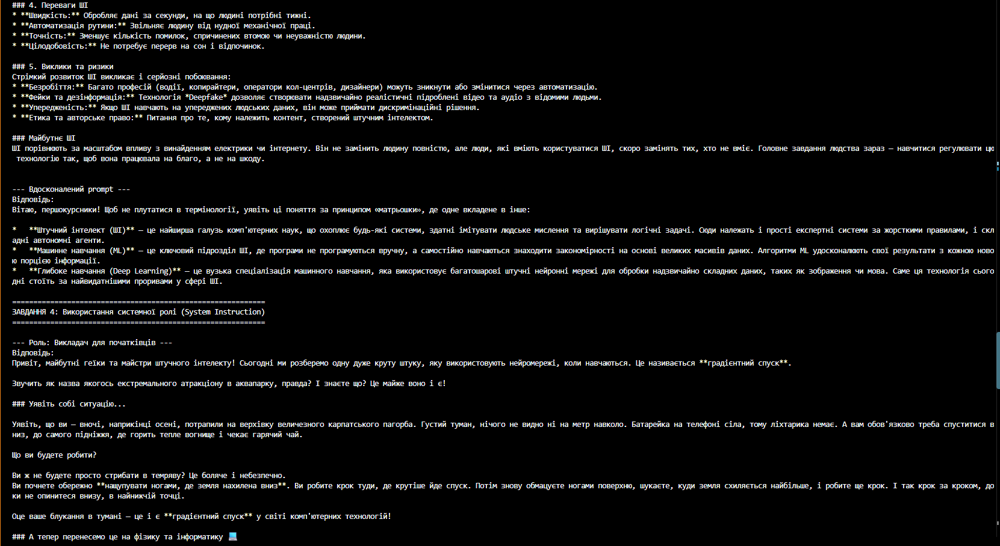
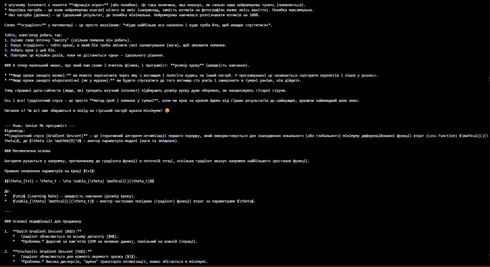
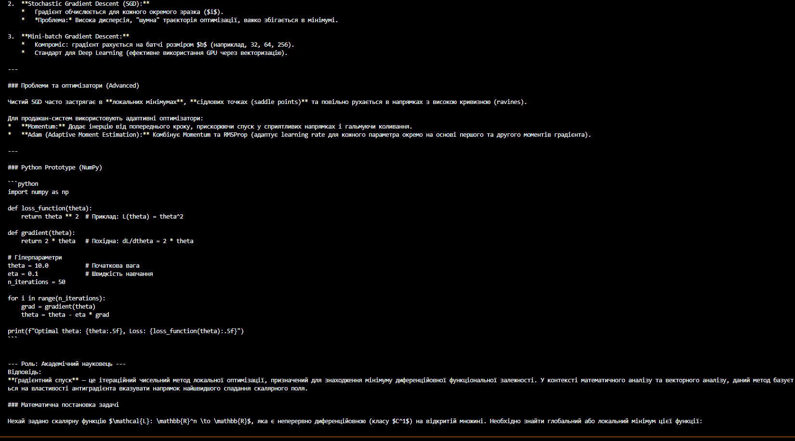
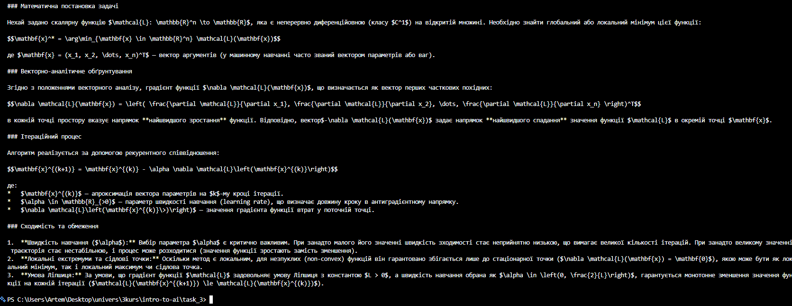

# Лабораторна робота №3: Робота з великими мовними моделями через API. Основи Prompt Engineering

**Виконав:** студент групи 311 Чубей Артем  
**Використана модель (LLM):** `gemini-3.5-flash-lite` (Google Gemini API)  
**Технологічний стек:** Python 3.13, `google-genai`, `python-dotenv`  
**Предметна область експериментів:** Штучний інтелект та нейронні мережі

## 📌 Мета роботи

Ознайомитися з принципами програмної взаємодії з великими мовними моделями (LLM) через API, опанувати методики структурування запитів (Prompt Engineering) та дослідити вплив прикладів (Few-shot), обмежень і системних інструкцій (`system_instruction`) на якість, стиль і формат згенерованої відповіді.

---

## 📂 Структура проєкту

```text
task_3/
├── app.py              # Основний Python-скрипт із реалізацією завдань 1–4 через API
├── requirements.txt    # Залежності проєкту (google-genai, python-dotenv)
├── .env                # Локальний файл із API-ключем (ігнорується Git)
├── screenshots/        # Скріншоти терміналу з реальними виводами моделі
└── README.md           # Документація лабораторної роботи
```

---

## ⚙️ Встановлення та запуск

1. **Перейдіть до директорії проєкту:**
   ```bash
   cd task_3
   ```

2. **Встановіть необхідні залежності:**
   ```bash
   pip install -r requirements.txt
   ```

3. **Налаштуйте змінну середовища:**  
   Створіть у корені папки `task_3` файл `.env` та додайте свій ключ доступу з Google AI Studio:
   ```env
   GEMINI_API_KEY=api_ключ
   ```

4. **Запустіть скрипт:**
   ```bash
   python app.py
   ```

---

## 🧪 Зміст виконаних завдань (`app.py`)

### 1. Взаємодія з LLM: 5 базових типів запитів (`run_task_1`)
Реалізовано цикл запитів у межах предметної області «ШІ та нейронні мережі»:
* **Пояснення:** розкриття суті функції втрат (*Loss Function*) через побутову аналогію гри в дартс та числовий приклад оцінки вартості нерухомості.
* **Генерація тексту:** створення вступного абзацу про актуальність згорткових нейромереж (*CNN*) у комп'ютерному зорі з жорстким лімітом до 60 слів (отримано 49 слів).
* **Переклад:** технічний переклад визначення алгоритму градієнтного спуску (*Gradient Descent*) з англійської мови з термінологічним глосарієм.
* **Узагальнення (Summary):** стиснення тексту про явище перенавчання (*overfitting*) до двох лаконічних тез (суть проблеми та методи боротьби).
* **Генерація списку:** формування переліку з 4 оптимізаторів (`SGD`, `Adam`, `RMSprop`, `AdamW`) за заданим шаблоном `Назва: особливість`.

### 2. Порівняння Zero-shot та Few-shot prompting (`run_task_2`)
* **Zero-shot:** модель коректно класифікувала гіперпараметр `learning_rate` (категорія *Оптимізація*, тип *Float*), але додала розмовний вступ і маркований список.
* **Few-shot (3 демонстраційні приклади):** модель повернула суворо детермінований рядок без зайвих символів:
  ```text
  learning_rate | Оптимізація | float
  ```

### 3. Удосконалення абстрактного промпту (`run_task_3`)
* **Початковий запит** (*«Розкажи про штучний інтелект»*) згенерував велику оглядову статтю на 6 розділів із неконтрольованим обсягом.
* **Вдосконалений запит** із заданням **ролі** (викладач університету), **цільової аудиторії** (першокурсники CS), **структури** (принцип «матрьошки» для AI → ML → DL, по 2 речення на пункт) та **ліміту обсягу** дав точний педагогічний конспект.

### 4. Дослідження системної ролі (`run_task_4`)
За допомогою параметра `types.GenerateContentConfig(system_instruction=...)` досліджено відповіді на одне запитання (*«Що таке градієнтний спуск?»*) у трьох ролях:
* **Викладач для початківців:** пояснення через метафору нічного спуску з гори в тумані.
* **Senior ML-інженер:** формула оновлення ваг $\theta_{t+1} = \theta_t - \eta \nabla_{\theta}\mathcal{L}(\theta_t)$, порівняння `BGD`, `SGD` і `Mini-batch GD`, а також прототип коду на Python (`NumPy`).
* **Академічний науковець:** векторний аналіз, антиградієнт $-\nabla\mathcal{L}(\mathbf{x})$, рекурентний процес та умова збіжності Ліпшиця $\alpha \in (0, 2/L)$.

---

## 📸 Демонстрація роботи (Скріншоти консолі)















---

## 💡 Підсумкові висновки

1. **Програмна інтеграція:** використання офіційного `google-genai` SDK дає змогу автоматизувати тестування серій промптів і програмно керувати системними інструкціями.
2. **Ефективність Few-shot:** надання 2–3 зразків виводу гарантує дотримання суворого машиночитаного синтаксису без додаткового тексту.
3. **Керування контекстом і ролями:** поєднання чітких обмежень у запиті та `system_instruction` дозволяє гнучко адаптувати складність викладу матеріалу від шкільного рівня до формального математичного аналізу.