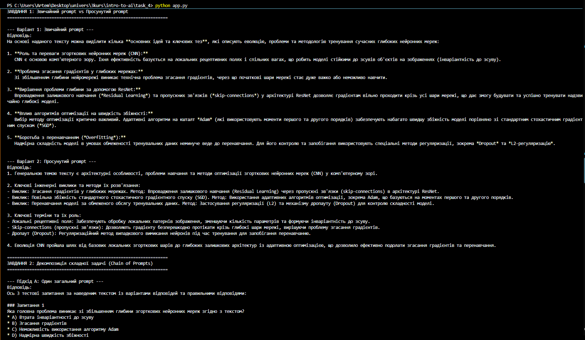
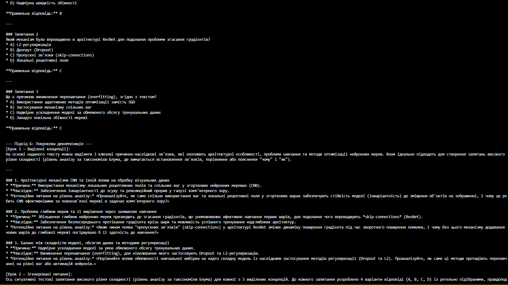
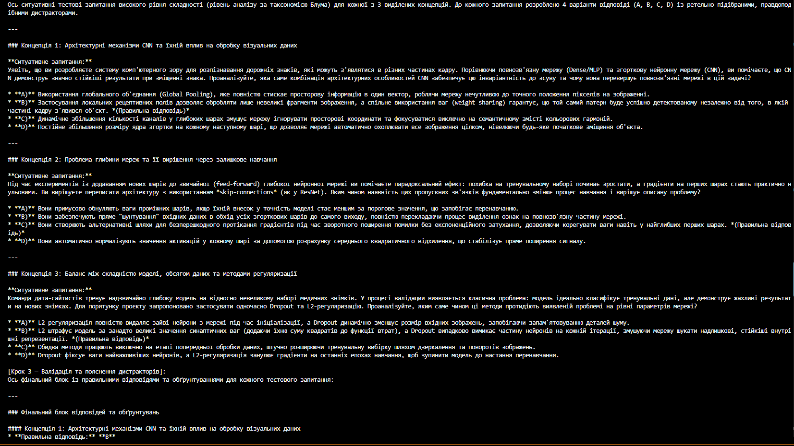
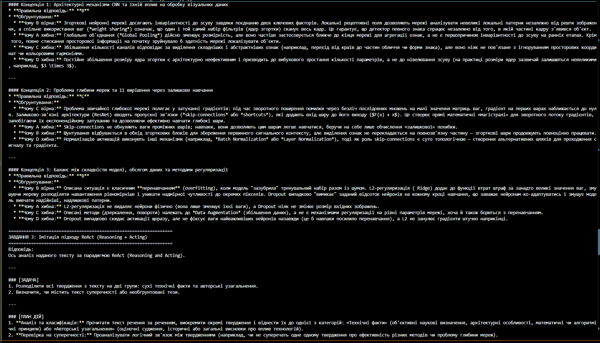
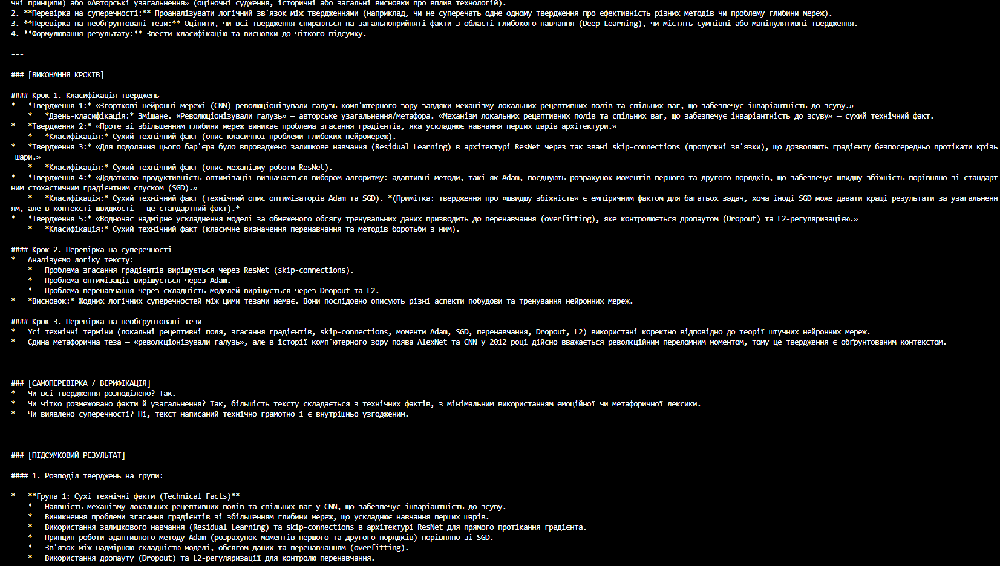
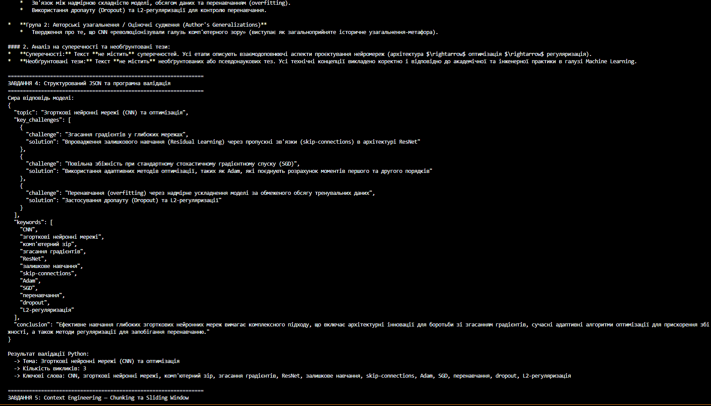
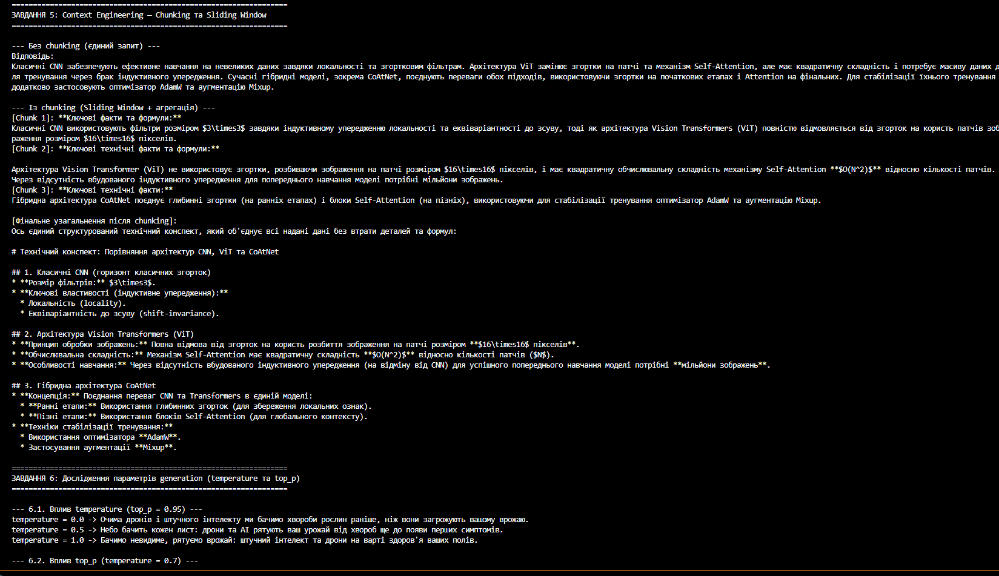
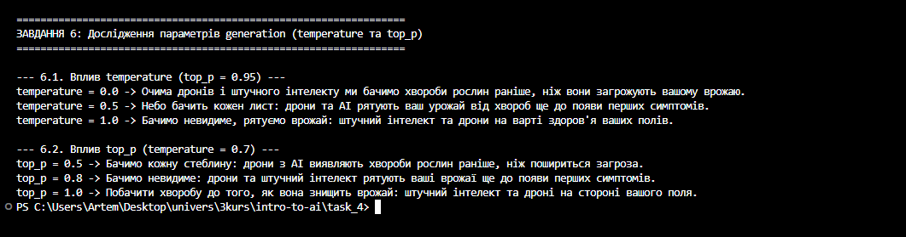

# Лабораторна робота №4: Просунутий Prompt Engineering, Context Engineering та керування генерацією

**Виконав:** студент групи 311 Чубей Артем  
**Використана модель (LLM):** `gemini-3.5-flash-lite` (Google Gemini API)  
**Технологічний стек:** Python 3.13, `google-genai`, `python-dotenv`  
**Предметна область експериментів:** Глибокі нейронні мережі, архітектури комп'ютерного зору (CNN, ViT, CoAtNet) та методи оптимізації

## 📌 Мета роботи

Ознайомитися з просунутими техніками формування запитів до великих мовних моделей через API (`Chain of Prompts`, `ReAct`, строгий JSON-вивід), дослідити методи роботи з великим контекстом (`Context Engineering`, `chunking`, `sliding window`) та проаналізувати вплив параметрів генерації (`temperature` і `top_p`) на детермінованість і креативність відповідей моделі.

---

## 📂 Структура проєкту

```text
task_4/
├── app.py              # Основний Python-скрипт із реалізацією завдань 1–6 та rate-limit захистом
├── requirements.txt    # Залежності проєкту (google-genai, python-dotenv)
├── .env                # Локальний файл із API-ключем (ігнорується Git)
├── screenshots/        # Скріншоти терміналу з реальними виводами моделі
└── README.md           # Документація лабораторної роботи
```

---

## ⚙️ Встановлення та запуск

1. **Перейдіть до директорії проєкту:**
   ```bash
   cd task_4
   ```

2. **Встановіть необхідні залежності:**
   ```bash
   pip install -r requirements.txt
   ```

3. **Налаштуйте змінну середовища:**  
   Створіть у корені папки `task_4` файл `.env` та додайте свій ключ доступу з Google AI Studio:
   ```env
   GEMINI_API_KEY=ваш_api_ключ
   ```

4. **Запустіть скрипт:**
   ```bash
   python app.py
   ```
   > **Примітка:** У функцію `ask_gemini()` вбудовано паузу `5.0` секунд між запитами (для дотримання ліміту безкоштовного тарифу `15 RPM`) та механізм автоматичного повтору при тимчасових помилках `503` / `429`.

---

## 🧪 Зміст виконаних завдань (`app.py`)

### 1. Звичайний проти просунутого prompt (`run_task_1`)
* **Звичайний запит:** модель згенерувала вступну фразу та загальний описовий список із 5 тез без жорсткої аналітичної структури.
* **Просунутий запит** (роль дослідника Deep Learning, контекст магістратури, покрокова декомпозиція на 4 розділи, ліміт до 30 слів на висновок та заборона вступного тексту): отримано строго структурований технічний розбір із фінальним висновком на 24 слова.

### 2. Декомпозиція складної задачі (`run_task_2`)
* **Підхід А (один загальний запит):** сформовано 3 базові запитання на поверхневе відтворення фактів із тексту без обґрунтування варіантів.
* **Підхід Б (Chain of Prompts: Крок 1 → Крок 2 → Крок 3):**
  1. Виділено 3 причинно-наслідкові зв'язки рівня аналізу за таксономією Блума.
  2. Сгенеровано ситуативні інженерні кейси з реалістичними дистракторами (`Global Pooling`, `Batch Normalization`, `Data Augmentation`).
  3. Додано блок валідації з поясненням, чому правильний варіант вірний, а три інші — хибні.

### 3. Парадигма ReAct (`run_task_3`)
За схемою `[ЗАДАЧА] -> [ПЛАН ДІЙ] -> [ВИКОНАННЯ КРОКІВ] -> [САМОПЕРЕВІРКА] -> [ПІДСУМКОВИЙ РЕЗУЛЬТАТ]` модель розмежувала 6 сухих технічних фактів і 1 авторське узагальнення-метафору (*«революціонізували галузь»*), підтвердила відсутність суперечностей та додала фахове уточнення щодо різниці між швидкістю збіжності `Adam` та узагальнювальною здатністю `SGD`.

### 4. Структурований JSON та програмна валідація (`run_task_4`)
* За допомогою `response_mime_type="application/json"` та `temperature=0.1` отримано чистий валідний JSON-об'єкт з полями `topic`, `key_challenges`, `keywords` та `conclusion`.
* Функція `parse_and_validate_llm_json()` успішно розпарсила відповідь через `json.loads()` та перевірила наявність усіх обов'язкових ключів.

### 5. Context Engineering: Chunking та Sliding Window (`run_task_5`)
* **Без chunking (єдиний запит):** у стислому переказі загубилися конкретні розмірності фільтрів ($3 \times 3$), розмір патчів ViT ($16 \times 16$) та формула складності Self-Attention $O(N^2)$.
* **Із chunking (`chunk_size=45`, `overlap=12` + фінальна агрегація):** розбиття тексту методом ковзного вікна з перекриттям зберегло кожну формулу, розмірність і технічну деталь у фінальному конспекті.

### 6. Дослідження параметрів генерації (`run_task_6`)
Проведено серію запусків генерації слогана для AI-стартапу в агросекторі:
* **`temperature` (`0.0`, `0.5`, `1.0` при `top_p=0.95`):** при `0.0` отримано максимально буквальний і детермінований опис функції продукту; при `0.5` та `1.0` з'явилися виразні рекламні метафори (*«Небо бачить кожен лист»*, *«Бачимо невидиме, рятуємо врожай»*).
* **`top_p` (`0.5`, `0.8`, `1.0` при `temperature=0.7`):** розширення ядра вибірки з `0.5` до `1.0` збільшило лексичну варіативність та змінило синтаксичну конструкцію слогана.

---

## 📸 Демонстрація роботи (Скріншоти консолі)

















---

## 💡 Підсумкові висновки

1. **Керування якістю виводу:** поєднання структурованого промптингу, ланцюжків декомпозиції (`Chain of Prompts`) та парадигми `ReAct` значно підвищує аналітичну глибину відповідей LLM порівняно з одинарними запитами.
2. **Машиночитана інтеграція:** використання `response_mime_type="application/json"` у Google GenAI SDK гарантує стабільний JSON-вивід, придатний для автоматичної валідації в Python.
3. **Масштабування контексту:** алгоритм `Sliding Window` з перекриттям чанків ефективно запобігає втраті технічних деталей і формул під час обробки багатороздільних документів.
4. **Баланс точності та креативності:** низькі значення `temperature` (`0.0–0.2`) оптимальні для аналітики й JSON-генерації, тоді як середні та високі (`0.5–1.0`) — для генерації маркетингових слоганів і творчих текстів.