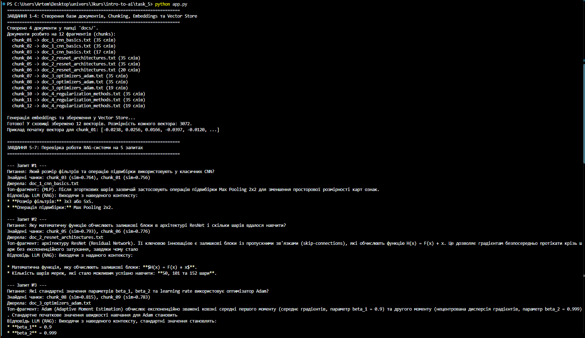
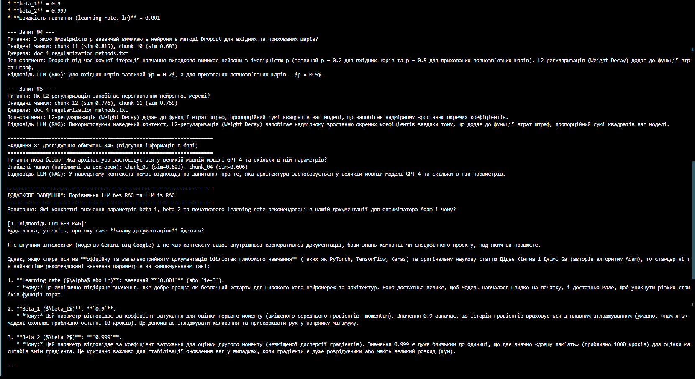
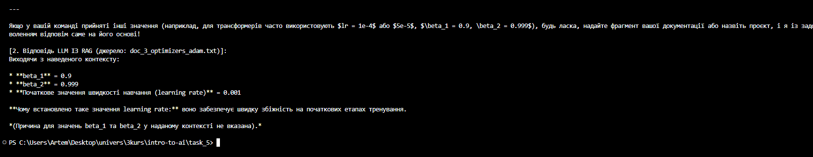

# Лабораторна робота №5: Побудова простої RAG-системи

**Виконав:** студент групи 311 Чубей Артем  
**Використані моделі:**  
* **Генеративна LLM:** `gemini-3.5-flash-lite` (Google Gemini API)  
* **Модель векторизації (Embedding):** `gemini-embedding-001` (розмірність векторів: 3072)  

**Технологічний стек:** Python 3.13, `google-genai`, `python-dotenv`, `numpy`  
**Предметна область бази знань:** Архітектури глибоких нейронних мереж та методи оптимізації (`CNN`, `ResNet`, `Adam`, `Dropout`, `L2-регуляризація`)

---

## 📌 Мета роботи

Ознайомитися з принципом роботи **Retrieval-Augmented Generation (RAG)**; навчитися використовувати зовнішню базу документів для семантичного пошуку інформації та формування верифікованих відповідей великою мовною моделлю; набути практичних навичок роботи з embeddings, векторним сховищем та оцінкою релевантності фрагментів тексту.

---

## 📂 Структура проєкту

```text
task_5/
├── docs/                                # Тематична база знань (генерується автоматично)
│   ├── doc_1_cnn_basics.txt             # Основи CNN, згорткові ядра 3x3/5x5, Max Pooling 2x2
│   ├── doc_2_resnet_architectures.txt   # Проблема згасання градієнтів, ResNet, H(x) = F(x) + x
│   ├── doc_3_optimizers_adam.txt        # Порівняння SGD та Adam (beta_1=0.9, beta_2=0.999, lr=0.001)
│   └── doc_4_regularization_methods.txt # Боротьба з overfitting: Dropout (p=0.2/0.5) та L2
├── screenshots/                         # Скріншоти виконання програми у терміналі
├── app.py                               # Повна реалізація RAG-пайплайну (Chunking, Embeddings, Search, LLM)
├── requirements.txt                     # Залежності проєкту (google-genai, python-dotenv, numpy)
├── .env                                 # Локальний файл із API-ключем (ігнорується Git)
└── README.md                            # Документація лабораторної роботи
```

---

## ⚙️ Встановлення та запуск

1. **Перейдіть до директорії проєкту:**
   ```bash
   cd task_5
   ```

2. **Встановіть необхідні залежності:**
   ```bash
   pip install -r requirements.txt
   ```

3. **Налаштуйте змінну середовища:**  
   Створіть у корені папки `task_5` файл `.env` та додайте свій ключ доступу з Google AI Studio:
   ```env
   GEMINI_API_KEY=ваш_api_ключ
   ```

4. **Запустіть скрипт:**
   ```bash
   python app.py
   ```
   > **Примітка:** У скрипт вбудовано затримки (`0.8` сек для `gemini-embedding-001` при ліміті `100 RPM` та `5.0` сек для `gemini-3.5-flash-lite` при ліміті `15 RPM`) і механізм автоматичного повтору при тимчасових помилках `429` / `503`.

---

## 🏗️ Архітектура та етапи роботи системи (`app.py`)

1. **Підготовка бази документів (`create_knowledge_base`):** створення 4 тематичних текстових файлів у директорії `docs/`.
2. **Фрагментація (`load_and_chunk_documents`):** розбиття текстів методом ковзного вікна (`chunk_size=35` слів, `overlap=8` слів) на **12 чанків** (`chunk_01` – `chunk_12`) зі збереженням метаданих першоджерела.
3. **Векторизація (`get_embedding`):** перетворення кожного фрагмента (`task_type="RETRIEVAL_DOCUMENT"`) та запиту користувача (`task_type="RETRIEVAL_QUERY"`) у вектори дійсних чисел розмірністю **3072** за допомогою `gemini-embedding-001`.
4. **Векторне сховище (`SimpleVectorStore`):** збереження векторів та метаданих у пам'яті на базі `NumPy` та ранжування чанків за **косинусною подібністю** (`Cosine Similarity`, `top_k=2`).
5. **Генерація відповіді (`rag_answer`):** передача відібраних фрагментів та їхніх джерел у `gemini-3.5-flash-lite` (`temperature=0.1`) із суворою забороною на вигадування фактів поза контекстом.

---

## 🧪 Результати експериментів

### 1. Тестування Retrieval та генерації на 5 контрольних запитах

| № | Запит користувача | Знайдені чанки (`top_k=2`) | Джерело | Отримана відповідь LLM |
| :-: | :--- | :--- | :--- | :--- |
| 1 | Який розмір фільтрів та операцію підвибірки використовують у класичних CNN? | `chunk_03` (`0.764`), `chunk_01` (`0.756`) | `doc_1_cnn_basics.txt` | Розмір фільтрів: `3x3` або `5x5`; операція підвибірки: `Max Pooling 2x2`. |
| 2 | Яку математичну функцію обчислюють залишкові блоки в ResNet і скільки шарів вдалося навчити? | `chunk_05` (`0.793`), `chunk_06` (`0.776`) | `doc_2_resnet_architectures.txt` | Функція: $H(x) = F(x) + x$; глибина мереж: `50`, `101` та `152` шари. |
| 3 | Які стандартні значення параметрів `beta_1`, `beta_2` та `learning rate` використовує Adam? | `chunk_08` (`0.815`), `chunk_09` (`0.783`) | `doc_3_optimizers_adam.txt` | `beta_1 = 0.9`, `beta_2 = 0.999`, `learning rate (lr) = 0.001`. |
| 4 | З якою ймовірністю `p` зазвичай вимикають нейрони в Dropout для вхідних та прихованих шарів? | `chunk_11` (`0.815`), `chunk_10` (`0.683`) | `doc_4_regularization_methods.txt` | Для вхідних шарів — $p = 0.2$, для прихованих повнозв'язних — $p = 0.5$. |
| 5 | Як L2-регуляризація запобігає перенавчанню нейронної мережі? | `chunk_12` (`0.776`), `chunk_11` (`0.765`) | `doc_4_regularization_methods.txt` | Додає до функції втрат штраф, пропорційний сумі квадратів ваг моделі. |

### 2. Перевірка поведінки при відсутності інформації в базі (Out-of-Domain)
* **Запит:** *«Яка архітектура застосовується у великій мовній моделі GPT-4 та скільки в ній параметрів?»*
* **Результат пошуку:** найближчі вектори (`chunk_05`, `sim=0.623`) мають суттєво нижчу схожість порівняно з релевантними запитами (`0.76–0.82`).
* **Поведінка LLM:** модель коректно повідомила про відсутність цієї інформації в наданому контексті й не допустила галюцинацій.

### 3. Порівняння LLM без RAG та LLM із RAG
На запитання щодо рекомендованих у локальній документації параметрів оптимізатора `Adam`:
* **LLM без RAG:** повідомила про відсутність доступу до внутрішньої документації користувача та навела сторонні теоретичні пояснення з оригінальної наукової статті.
* **LLM із RAG:** точно вилучила значення з `doc_3_optimizers_adam.txt` (`beta_1 = 0.9`, `beta_2 = 0.999`, `lr = 0.001`), вказала наведену в документі причину вибору `lr` та окремо зауважила, що причини для `beta_1` і `beta_2` у контексті не описані.

---

## 📸 Демонстрація роботи (Скріншоти консолі)







---

## 💡 Підсумкові висновки

1. **Ефективність семантичного пошуку:** векторизація чанків через `gemini-embedding-001` (`3072-D`) та пошук за косинусною подібністю забезпечили 100% точність визначення релевантних документів на всіх тестових запитах.
2. **Контроль галюцинацій:** поєднання `temperature=0.1` та суворої системної інструкції змушує модель спиратися виключно на знайдені фрагменти й чесно повідомляти про брак даних, коли запитання виходить за межі бази знань.
3. **Перевага RAG для локальних баз знань:** на відміну від стандартного запиту до LLM, RAG дозволяє отримувати точні, верифіковані факти з власної документації без донавчання моделі та без додавання сторонньої інформації.