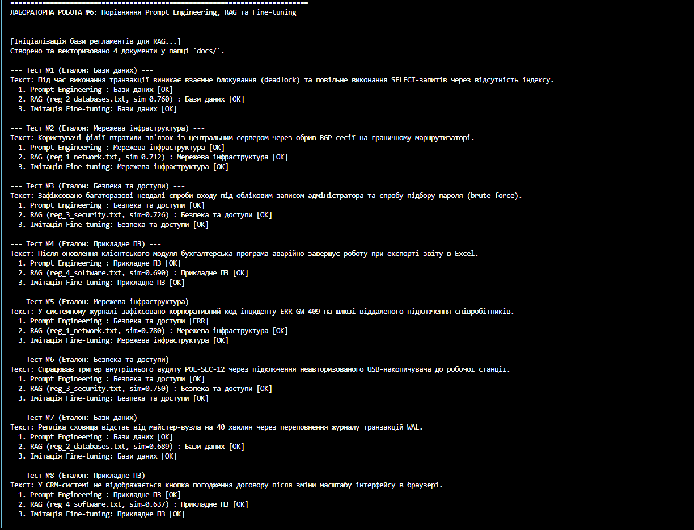
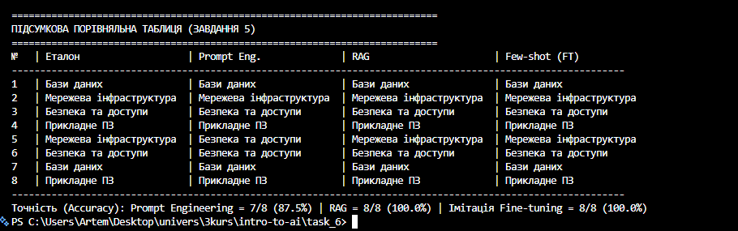

# Лабораторна робота №6: Порівняння підходів — Prompt Engineering, RAG та Fine-tuning

**Виконав:** студент групи 311 Чубей Артем  
**Використані моделі:**  
- **Генеративна LLM:** `gemini-3.5-flash-lite` (Google Gemini API, `temperature=0.0`)  
- **Модель векторизації (Embedding):** `gemini-embedding-001` (розмірність векторів: `3072`)  

**Технологічний стек:** Python 3.13, `google-genai`, `python-dotenv`, `numpy`  
**Задача експерименту:** Автоматична класифікація технічних інцидентів ІТ-підтримки за 4 категоріями (`Мережева інфраструктура`, `Бази даних`, `Безпека та доступи`, `Прикладне ПЗ`)

---

## 📌 Мета роботи

Дослідити три підходи до адаптації великої мовної моделі до прикладної задачі — **Prompt Engineering (Zero-shot)**, **RAG (Retrieval-Augmented Generation)** та **імітацію Fine-tuning (Few-shot prompting)** — на єдиному наборі тестових даних і визначити область доцільного застосування кожного методу.

---

## 📂 Структура проєкту

```text
task_6/
├── docs/                        # База корпоративних регламентів для RAG (генерується автоматично)
│   ├── reg_1_network.txt        # Регламент мережевої інфраструктури (BGP, код ERR-GW-409)
│   ├── reg_2_databases.txt      # Регламент баз даних (deadlock, індекси, журнал WAL)
│   ├── reg_3_security.txt       # Регламент безпеки (brute-force, політика POL-SEC-12)
│   └── reg_4_software.txt       # Регламент прикладного ПЗ (CRM, бухгалтерські програми)
├── screenshots/                 # Скріншоти виконання програми у терміналі
├── app.py                       # Скрипт порівняльного тестування всіх 3 підходів на 8 кейсах
├── requirements.txt             # Залежності проєкту (google-genai, python-dotenv, numpy)
├── .env                         # Локальний файл із API-ключем (ігнорується Git)
└── README.md                    # Документація лабораторної роботи
```

---

## ⚙️ Встановлення та запуск

1. **Перейдіть до директорії проєкту:**
   ```bash
   cd task_6
   ```

2. **Встановіть необхідні залежності:**
   ```bash
   pip install -r requirements.txt
   ```

3. **Налаштуйте змінну середовища:**  
   Створіть у корені папки `task_6` файл `.env` та додайте ключ Google AI Studio:
   ```env
   GEMINI_API_KEY=ваш_api_ключ
   ```

4. **Запустіть скрипт:**
   ```bash
   python app.py
   ```

---

## 📊 Результати порівняльного експерименту

Усі підходи протестовано на **8 однакових тестових прикладах**:

| № | Сутність інциденту | Еталон | Prompt Eng. | RAG (джерело, `sim`) | Імітація Fine-tuning |
| :-: | :--- | :--- | :---: | :---: | :---: |
| 1 | `Deadlock` та повільні `SELECT` через брак індексу | `Бази даних` | ✅ | ✅ (`reg_2`, `0.760`) | ✅ |
| 2 | Обрив `BGP`-сесії на маршрутизаторі філії | `Мережева інфраструктура` | ✅ | ✅ (`reg_1`, `0.712`) | ✅ |
| 3 | Спроби підбору пароля (`brute-force`) адміністратора | `Безпека та доступи` | ✅ | ✅ (`reg_3`, `0.726`) | ✅ |
| 4 | Аварійне завершення бухгалтерського ПЗ при експорті в Excel | `Прикладне ПЗ` | ✅ | ✅ (`reg_4`, `0.690`) | ✅ |
| 5 | Корпоративний код `ERR-GW-409` на шлюзі підключення | `Мережева інфраструктура` | ❌ (`Безпека та доступи`) | ✅ (`reg_1`, `0.780`) | ✅ |
| 6 | Тригер внутрішнього аудиту `POL-SEC-12` (USB-носій) | `Безпека та доступи` | ✅ | ✅ (`reg_3`, `0.750`) | ✅ |
| 7 | Відставання репліки БД через переповнення журналу `WAL` | `Бази даних` | ✅ | ✅ (`reg_2`, `0.689`) | ✅ |
| 8 | Помилка відображення кнопки в CRM після зміни масштабу | `Прикладне ПЗ` | ✅ | ✅ (`reg_4`, `0.637`) | ✅ |
| **Разом** | **Точність ($\text{Accuracy}$)** | **100.0% (8/8)** | **87.5% (7/8)** | **100.0% (8/8)** | **100.0% (8/8)** |

---

## 📸 Демонстрація роботи (Скріншоти консолі)





---

## 💡 Ключові висновки

1. **Prompt Engineering (`87.5%`)** є найшвидшим у реалізації та ідеально підходить для загальнотехнічних задач, але помиляється там, де потрібні закриті правила компанії (`ERR-GW-409`).
2. **RAG (`100.0%`)** забезпечує максимальну точність і прозорість завдяки пошуку в корпоративних регламентах (`sim=0.780` для `reg_1_network.txt`) та легко оновлюється без перенавчання моделі.
3. **Імітація Fine-tuning / Few-shot (`100.0%`)** ефективно засвоює специфічні патерни з наведених зразків, а реальний Fine-tuning доцільний при великих обсягах прикладів для закріплення стилю чи формату відповіді.