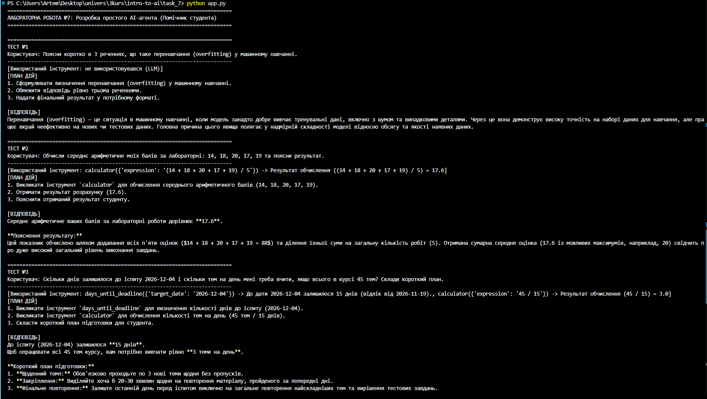
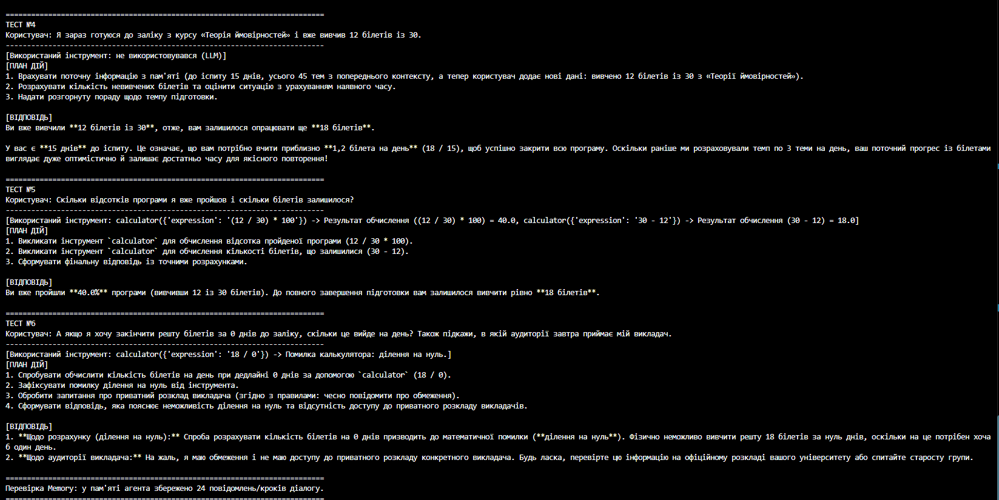

# Лабораторна робота №7: Розробка простого AI-агента (Помічник студента)

**Виконав:** студент групи 311 Чубей Артем  
**Використана модель:** `gemini-3.5-flash-lite` (Google Gemini API, нативний механізм Function/Tool Calling, `temperature=0.1`)  
**Технологічний стек:** Python 3.13, `google-genai`, `python-dotenv`  
**Варіант реалізації:** Варіант 1 — Помічник студента (`StudyAssistantAgent`)

---

## 📌 Мета роботи

Ознайомитися з принципами побудови **AI-агентів**; навчитися створювати інтелектуальну систему, яка самостійно планує послідовність дій для виконання поставленого завдання, викликає зовнішні інструменти (Tools) за потреби та зберігає історію попередньої взаємодії з користувачем (Memory).

---

## 📂 Структура проєкту

```text
task_7/
├── screenshots/             # Скріншоти виконання програми у терміналі
│   ├── output_1.png         # Тести 1–3 (без інструмента, calculator, багатокроковий план)
│   └── output_2.png         # Тести 4–6 (перевірка Memory, помилка 18/0 та обмеження агента)
├── app.py                   # Реалізація AI-агента з плануванням, Tool Calling та Memory
├── requirements.txt         # Залежності проєкту (google-genai, python-dotenv)
├── .env                     # Локальний файл із API-ключем (ігнорується Git)
└── README.md                # Документація лабораторної роботи
```

---

## ⚙️ Встановлення та запуск

1. **Перейдіть до директорії проєкту:**
   ```bash
   cd task_7
   ```

2. **Встановіть необхідні залежності:**
   ```bash
   pip install -r requirements.txt
   ```

3. **Налаштуйте змінну середовища:**  
   Створіть у корені папки `task_7` файл `.env` та додайте ключ доступу з Google AI Studio:
   ```env
   GEMINI_API_KEY=ваш_api_ключ
   ```

4. **Запустіть скрипт:**
   ```bash
   python app.py
   ```

---

## 🛠️ Зовнішні інструменти агента (Tools)

Агент самостійно визначає, коли йому достатньо власних знань LLM, а коли необхідно викликати зовнішню Python-функцію:

| Інструмент | Призначення | Вхідні дані | Результат |
| :--- | :--- | :--- | :--- |
| `calculator` | Безпечне обчислення арифметичних виразів і статистики через AST-парсер (захист від неточних обчислень LLM та ділення на нуль) | `expression: str` (наприклад, `'(14 + 18 + 20 + 17 + 19) / 5'`) | Рядок із точним числовим результатом або повідомленням про математичну помилку |
| `days_until_deadline` | Розрахунок кількості днів від поточної дати (`2026-11-19`) до дати іспиту чи здачі роботи | `target_date: str` у форматі `YYYY-MM-DD` (наприклад, `'2026-12-04'`) | Рядок із кількістю днів до дедлайну або повідомленням про його завершення |

---

## 🧪 Результати тестування агента (6 сценаріїв)

| № | Запит користувача | План агента (скорочено) | Використаний інструмент | Отриманий результат | Оцінка |
| :-: | :--- | :--- | :--- | :--- | :---: |
| 1 | Поясни коротко в 3 реченнях, що таке перенавчання (`overfitting`). | Сформулювати визначення -> обмежити 3 реченнями -> вивести відповідь. | Не використовувався (LLM) | Чітке пояснення поняття рівно у 3 реченнях без зайвих викликів функцій. | Виконано |
| 2 | Обчисли середнє арифметичне балів: `14, 18, 20, 17, 19` та поясни результат. | Викликати `calculator` -> отримати `17.6` -> пояснити результат. | `calculator('(14 + 18 + 20 + 17 + 19) / 5')` | Точне середнє значення `17.6` із роз'ясненням розрахунку. | Виконано |
| 3 | Скільки днів до іспиту `2026-12-04` і скільки тем на день вчити (всього 45 тем)? Склади план. | Викликати `days_until_deadline` -> викликати `calculator` -> скласти план. | `days_until_deadline('2026-12-04')`, `calculator('45 / 15')` | Визначено `15 днів`, обчислено `3.0 теми/день`, сформовано 3-кроковий план підготовки. | Виконано |
| 4 | Я готуюся до заліку з курсу «Теорія ймовірностей» і вже вивчив 12 білетів із 30. | Врахувати `15 днів` із Memory -> оцінити прогрес (`18 білетів` залишилося) -> дати пораду. | Не використовувався (LLM + Memory) | Агент зберегло у пам'яті `12 із 30` білетів і зіставив із `15 днями` з попереднього кроку (`1,2 білета/день`). | Виконано |
| 5 | Скільки відсотків програми я вже пройшов і скільки білетів залишилося? | Викликати `calculator` для відсотків -> викликати `calculator` для залишку. | `calculator('(12 / 30) * 100')`, `calculator('30 - 12')` | Без повторення чисел у запиті агент витягнув `12` і `30` із Memory та обчислив `40.0%` і `18 білетів`. | Виконано |
| 6 | А якщо закінчити решту білетів за `0` днів, скільки це на день? Де завтра приймає мій викладач? | Спробувати `calculator('18 / 0')` -> зафіксувати помилку -> повідомити про обмеження щодо розкладу. | `calculator('18 / 0')` (помилка ділення на нуль) | Коректно оброблено помилку ділення на нуль та чесно повідомлено про відсутність доступу до приватного розкладу. | Виконано (перевірка обмежень) |

---

## 📸 Демонстрація роботи (Скріншоти консолі)





---

## 💡 Підсумкові висновки

1. **Автономне планування та вибір інструментів:** розроблений AI-агент перед кожною відповіддю формує структурований блок `[ПЛАН ДІЙ]` і коректно визначає, чи потрібен виклик зовнішньої функції (наприклад, обійшовся без інструментів на теоретичному питанні №1, але послідовно викликав два інструменти у завданні №3).
2. **Ефективність діалогової пам'яті (Memory):** збереження історії діалогу (`24` кроки у `agent.memory`) дозволило агенту в Тесті №5 безпомилково оперувати числами `12` та `30` із попереднього повідомлення, навіть коли користувач їх не повторював.
3. **Безпечна обробка помилок та обмежень:** у Тесті №6 агент коректно перехопив виняток ділення на нуль від інструмента `calculator` і чесно повідомив про відсутність доступу до зовнішнього розкладу викладачів, уникнувши галюцинацій.