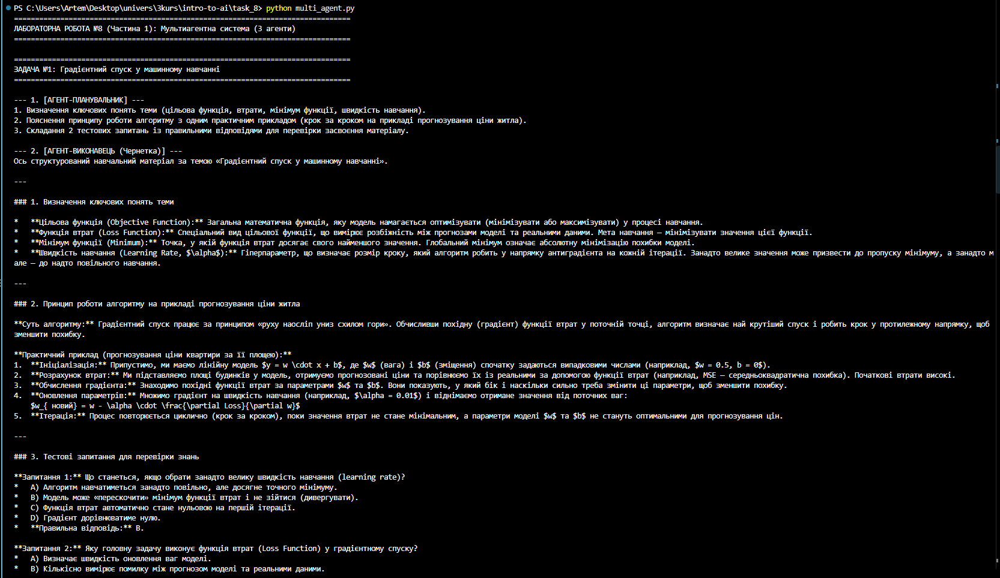
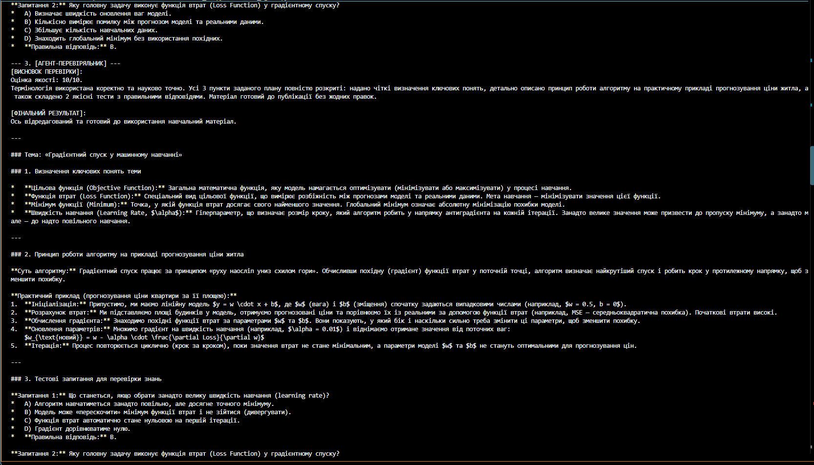
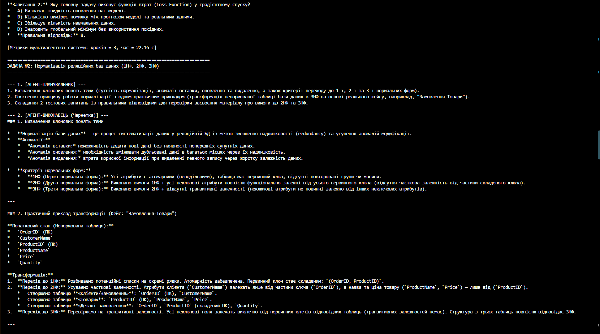
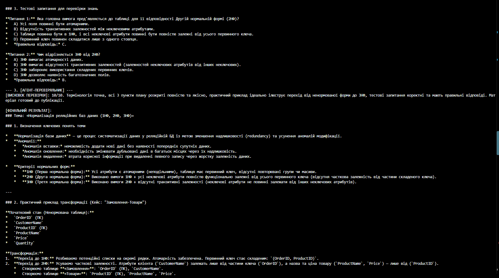
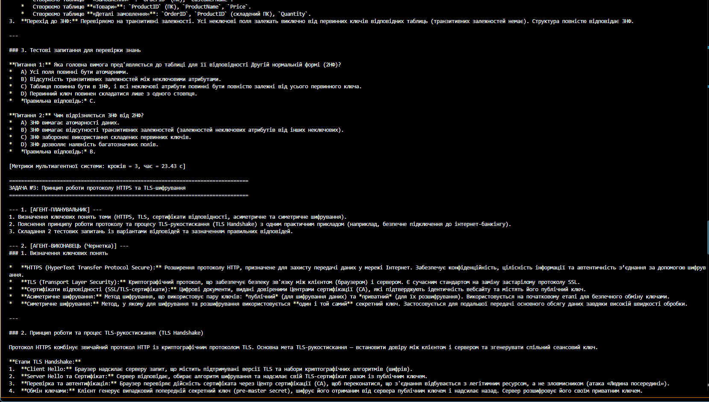
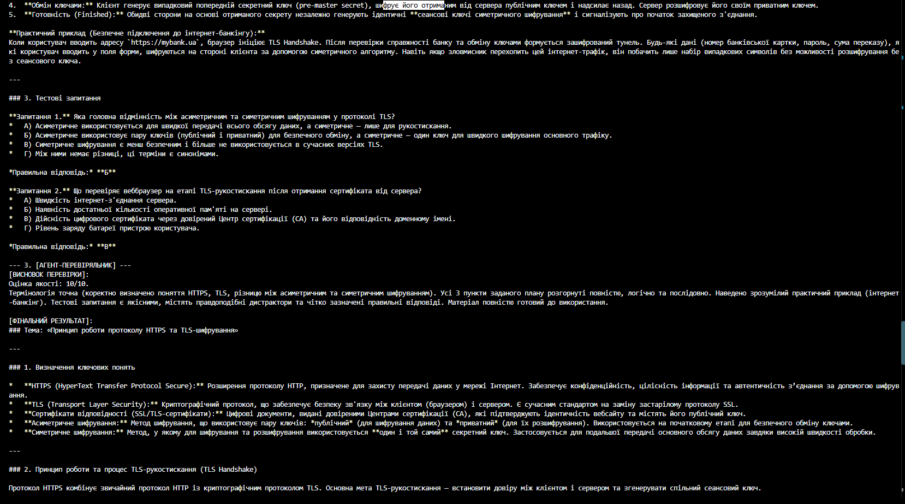
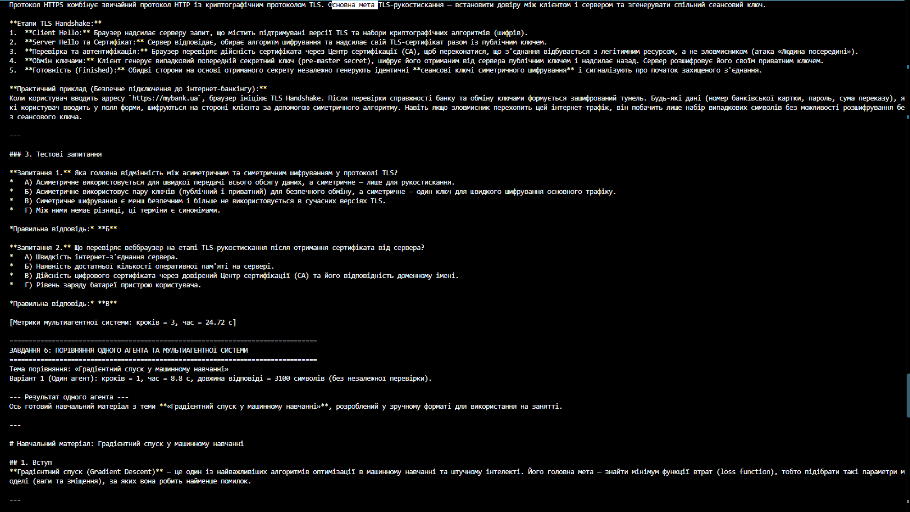
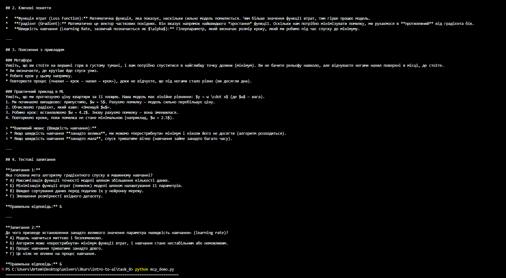
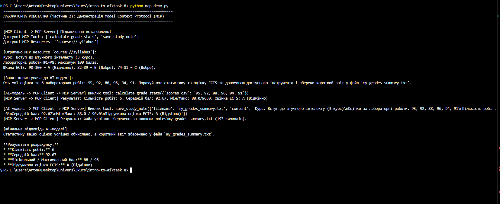

# Лабораторна робота №8: Мультиагентні системи та протокол MCP

**Виконав:** студент групи 311 Чубей Артем

**Використана модель (LLM):** `gemini-3.5-flash-lite` (Google Gemini API через Python SDK `google-genai`)

**Протокол MCP:** Model Context Protocol (`mcp >= 2.0.0`, клас `MCPServer`, транспорт `stdio`)

**Технологічний стек:** Python 3.13, `google-genai`, `python-dotenv`, `mcp`

## 📌 Мета роботи

Ознайомитися з принципами побудови **мультиагентних систем**; навчитися розподіляти складну задачу між спеціалізованими AI-агентами (Планувальник, Виконавець, Перевіряльник); дослідити принцип роботи **Model Context Protocol (MCP)** як сучасного стандарту підключення AI-моделей до зовнішніх інструментів і ресурсів.

## 📂 Структура проєкту

```
task_8/
├── notes/                       # Директорія для файлів, збережених через MCP tool
│   └── my_grades_summary.txt    # Звіт з оцінками, згенерований моделлю через MCP
├── screenshots/                 # Скріншоти виконання обох частин у терміналі
│   ├── output_1.1.png           # Мультиагентна система (Задачі 1–3)
│   ├── ...
│   ├── output_1.8.png           # Порівняння 1 агента та мультиагентної системи
│   └── output_2.1.png           # Демонстрація роботи MCP Client + MCP Server
├── multi_agent.py               # Частина 1: Мультиагентна система (3 агенти) + порівняння з 1 агентом
├── mcp_server.py                # Частина 2: MCP-сервер (2 tools + 1 resource)
├── mcp_demo.py                  # Частина 2: MCP-клієнт, інтегрований із Gemini
├── requirements.txt             # Залежності проєкту (google-genai, python-dotenv, mcp)
├── .env                         # Локальний файл із API-ключем (ігнорується Git)
└── README.md                    # Документація лабораторної роботи


```

## ⚙️ Встановлення та запуск

1. **Перейдіть до директорії проєкту:**

   ```
   cd task_8
   
   
   ```

2. **Встановіть необхідні залежності:**

   ```
   pip install -r requirements.txt
   
   
   ```

3. **Налаштуйте змінну середовища:**

   Створіть у корені папки `task_8` файл `.env` та додайте ключ доступу Google AI Studio:

   ```
   GEMINI_API_KEY=ваш_api_ключ
   
   
   ```

4. **Запустіть Частину 1 (мультиагентна система та порівняння):**

   ```
   python multi_agent.py
   
   
   ```

5. **Запустіть Частину 2 (демонстрація протоколу MCP):**

   ```
   python mcp_demo.py
   
   
   ```

## 🤖 Частина 1: Мультиагентна система (`multi_agent.py`)

Для задачі **підготовки навчального матеріалу** реалізовано конвеєр із трьох спеціалізованих агентів:

1. **`PlannerAgent` (Планувальник)** — декомпозує тему на 3 підзадачі (ключові поняття, пояснення з практичним прикладом, 2 контрольні тести).

2. **`ExecutorAgent` (Виконавець)** — формує структуровану чернетку навчального матеріалу за планом.

3. **`ReviewerAgent` (Перевіряльник)** — перевіряє точність термінології, повноту та правильність відповідей, виставляє оцінку (`10/10`) і формує фінальний варіант.

### Порівняння 1 агента та мультиагентної системи (тема: *«Градієнтний спуск у машинному навчанні»*)

| Архітектура | Кількість кроків | Час виконання | Незалежна перевірка | Особливості результату | 
| ----- | ----- | ----- | ----- | ----- | 
| **Один монолітний агент** | `1` | `8.80 с` | Відсутня | Швидка генерація, але без аудиту структури й точності | 
| **Мультиагентна система (3 агенти)** | `3` | `22.16 с` | Є (`10/10`) | Чітка декомпозиція, формули, перевірені тести й аудит редактора | 

## 🔌 Частина 2: Model Context Protocol (`mcp_server.py` + `mcp_demo.py`)

Реалізовано клієнт-серверну взаємодію за стандартом **MCP (`mcp >= 2.0.0`, транспорт `stdio`)**:

* **MCP Resource `course://syllabus`** — повертає програму курсу та шкалу оцінювання ECTS.

* **MCP Tool `calculate_grade_stats(scores_csv)`** — обчислює статистику оцінок (`Середній бал: 92.67`, `Мін/Макс: 88.0/96.0`, `Оцінка ECTS: A (Відмінно)`).

* **MCP Tool `save_study_note(filename, content)`** — зберігає підсумковий звіт у файл `notes/my_grades_summary.txt` (`193` символи).

## 📸 Демонстрація роботи (Скріншоти консолі)

### Частина 1. Мультиагентна система (`multi_agent.py`)

















---

### Частина 2. Model Context Protocol (`mcp_server.py` + `mcp_demo.py`)



## 💡 Ключові висновки

1. **Мультиагентна система** підвищує якість та надійність складних багатоетапних задач завдяки спеціалізації ролей і наявності етапу перевірки (`ReviewerAgent`), хоча й збільшує час виконання порівняно з одним агентом (`22.16 с` проти `8.80 с`).

2. **Протокол MCP** стандартизує підключення AI-моделей до зовнішніх інструментів і ресурсів, дозволяючи відокремити серверну логіку (`mcp_server.py`) від клієнтської LLM-логіки (`mcp_demo.py`).